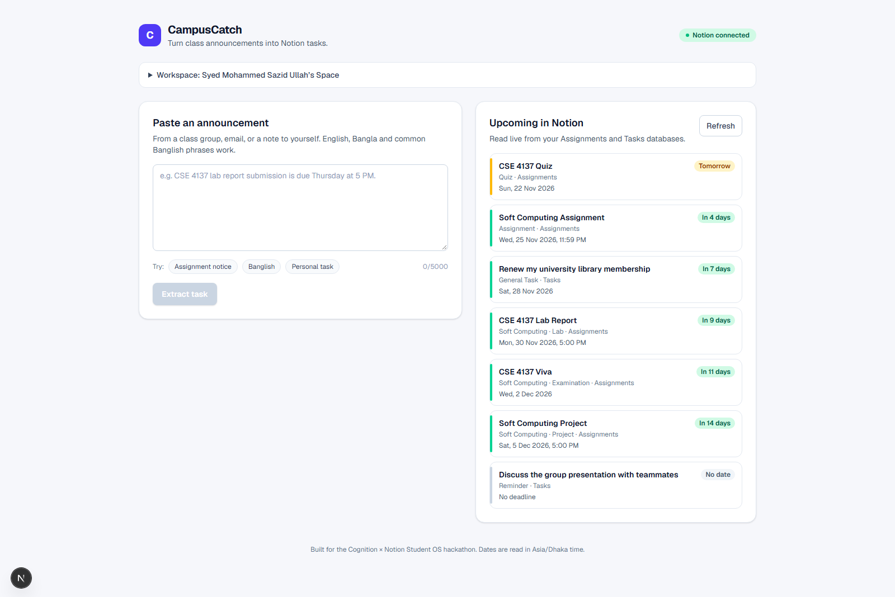
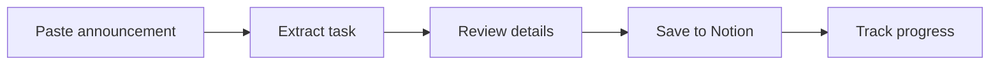
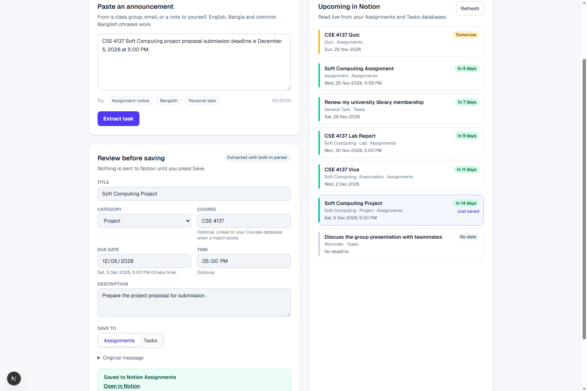
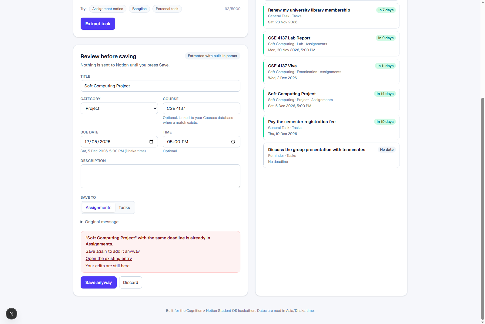
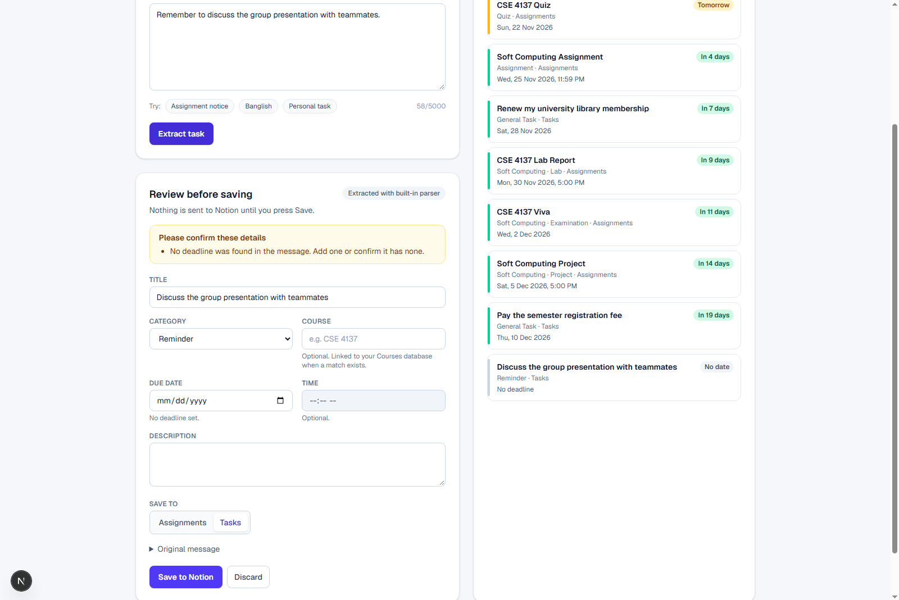
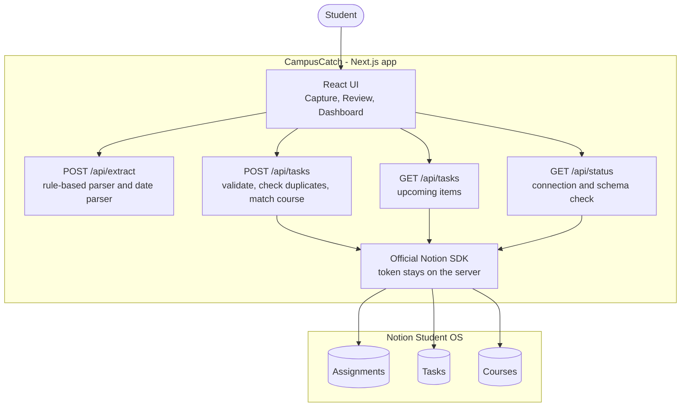

<div align="center">

# CampusCatch

**Turn everyday announcements into actionable tasks.**

CampusCatch helps university students turn scattered academic announcements and personal reminders into structured tasks inside their Notion Student OS.


**Category:** Student Productivity &nbsp;|&nbsp; **Hackathon:** Cognition × Notion Student OS Hackathon

[Problem](#the-problem) · [Solution](#our-solution) · [Demo](#product-demonstration) · [Notion integration](#notion-student-os-integration) · [Getting started](#getting-started) · [How we used Devin](#how-we-used-devin-chat)

</div>



<p align="center"><em>CampusCatch running locally. The list on the right is read live from the Assignments and Tasks databases in Notion.</em></p>

## In 15 seconds

| | |
| --- | --- |
| **What it does** | You paste an announcement. CampusCatch extracts the task, lets you correct it, and creates a real page in your Notion Student OS. |
| **Why students need it** | Deadlines arrive as chat messages and emails, then get buried. Copying each one into Notion by hand is the step that gets skipped. |
| **How Notion is used** | Tasks are written to and read from your own Assignments, Tasks and Courses databases through the official Notion API. There is no other database. |
| **How to try it** | `npm install`, add a Notion token to `.env.local`, `npm run dev`. See [Getting started](#getting-started). |

## The Problem

University deadlines do not arrive in one place. They come through WhatsApp and Messenger class groups, emails and notice boards, often in a mix of English, Bangla and Banglish.

- **Announcements get buried.** A deadline posted in a busy group chat is out of sight within minutes.
- **Manual entry is slow.** Moving a message into a planner means retyping the title, course, date and time.
- **Skipped entries become missed deadlines.** When capture takes effort, students rely on memory instead.

Students who already keep a Notion Student OS have a good place to track work. What is missing is a fast way to get announcements into it.

## Our Solution

CampusCatch is a capture layer in front of the Notion Student OS. It does not replace the workspace or keep its own task list: every task it saves is a Notion page, and everything it shows is read back from Notion.



1. **Paste** a message from a class group, an email or a note to yourself.
2. **Extract**: the title, course, category, deadline and description are pulled out by a rule-based parser.
3. **Review**: every field is editable, and nothing is sent to Notion until you press Save.
4. **Save**: a page is created in Assignments or Tasks, linked to the matching course when one exists.
5. **Track**: the dashboard lists your upcoming items from Notion, soonest first, with urgency labels. Completing a task is done in Notion.

## Key Features

Everything in this table is implemented. The "Verified" column says how each item was checked.

| Feature | What it does | Verified |
| --- | --- | --- |
| Announcement capture | Text box with sample messages, up to 5,000 characters | Browser test |
| Rule-based extraction | Title, course code, category, deadline and description from one message, using keywords and patterns | Unit tests, browser test |
| Deadline identification | Absolute dates, numeric dates, relative dates (`tomorrow`, `kalke`), weekday names and times, resolved in Asia/Dhaka time | Unit tests |
| Honest dates | A missing deadline stays empty and an ambiguous one is flagged for review. Dates are never invented | Unit tests, browser test |
| Multilingual input | English, Bangla script with Bangla digits, and common Banglish date words | Unit tests |
| Task categorisation | Assignment, Quiz, Examination, Lab, Project, Meeting, General Task, Reminder | Unit tests |
| Editable confirmation | Title, category, course, date, time, description and destination can all be changed before saving | Browser test |
| Notion save | Creates a real page through the official SDK and shows its link only after Notion confirms | Browser test against a real workspace |
| Course linking | Links the task to the matching page in Courses by course code or name | Live Notion test, unit tests |
| Duplicate detection | Warns when the same title and deadline already exist, with a link to the existing page | Browser test |
| Upcoming dashboard | Live list from Notion with Overdue, Due today, Tomorrow and "In N days" labels | Browser test |
| Unrelated messages | Small talk is reported as "no task found" instead of becoming a task | Unit tests, browser test |
| Error handling | Clear messages for empty input, malformed requests, invalid fields, and a missing or rejected Notion token. A failed save never shows a success message | API tests on a fresh clone |
| Schema detection | Reads each database's real properties instead of assuming names, with optional overrides | Unit tests |

**Implemented but not verified with a live model:** an optional extraction path that calls an OpenAI-compatible API when `LLM_API_KEY` is set. It is off by default and falls back to the rule-based parser on any failure. Everything described in this README uses the rule-based parser.

Planned work is listed separately under [Future Roadmap](#future-roadmap).

## Product Demonstration

**Input**, pasted into the capture box:

> CSE 4137 Soft Computing assignment must be submitted by November 25, 2026 at 11:59 PM.

**Output** of the rule-based parser, shown in the review card:

| Field | Extracted value |
| --- | --- |
| Title | Soft Computing Assignment |
| Course | CSE 4137 |
| Category | Assignment |
| Deadline | 25 November 2026, 11:59 PM (Asia/Dhaka) |
| Destination | Notion Assignments database |
| Needs review | No |

The student can change any field, then presses **Save to Notion**. CampusCatch creates the page, shows an **Open in Notion** link, and reloads the upcoming list from Notion so the new item appears there.



<p align="center"><em>Review and save. The announcement (top left) was extracted into editable fields, saved to the Assignments database, and now appears in the live list as "Just saved".</em></p>

| Duplicate protection | Missing deadline |
| --- | --- |
|  |  |
| Saving the same task twice shows a warning and a link to the existing page instead of creating a second one. | A message with no date is never given one. The date stays empty and the card asks for confirmation. |

All screenshots are from the recorded end-to-end test run against a real Notion workspace on 21 November 2026. The review and duplicate screenshots use the announcement "CSE 4137 Soft Computing project proposal submission deadline is December 5, 2026 at 5:00 PM."

More examples, each covered by a unit test:

| Announcement | Result |
| --- | --- |
| `Kalke amader CSE 4137 quiz ase.` | Quiz, CSE 4137, due tomorrow, flagged so the student confirms the date |
| `Renew my university library membership by November 28, 2026.` | General Task, 28 November 2026, saved to Tasks |
| `Remember to discuss the group presentation with teammates.` | Reminder with no deadline, flagged for review |
| `Hey everyone, how was your weekend?` | No task found |

## System Architecture



The app is a single Next.js project. The browser never talks to Notion directly: it calls three server-side route handlers, and only those handlers hold the Notion token.

| Part | Location | Responsibility |
| --- | --- | --- |
| UI | `src/components/` | Capture panel, review card, upcoming dashboard, connection panel |
| API routes | `src/app/api/` | `extract`, `tasks` (read and create), `status` |
| Extraction | `src/lib/extract/` | Category, course and title rules (`rules.ts`), date and time parsing (`dateParser.ts`) |
| Notion layer | `src/lib/notion/` | Client, schema detection, reading, creating, connection status |
| Setup script | `scripts/setup-notion.mjs` | Creates the three databases under a shared page |

There is no separate backend, no application database and no message scraping. Extraction does not need Notion, so it keeps working when Notion is not connected.

## Notion Student OS Integration

Notion is the product's only data store. CampusCatch has no task database of its own, so if Notion is not connected nothing can be saved or listed, and the app says so.

**1. Connection.** CampusCatch uses a Notion internal integration token (`NOTION_TOKEN`) with the official `@notionhq/client` SDK. The token is read only by server-side route handlers and never reaches the browser. The connection panel shows the workspace, which databases were found, and which properties were matched.

**2. Assignments database.** Academic items (Assignment, Quiz, Examination, Lab, Project) are saved here by default. The student can switch the destination before saving.

**3. Tasks database.** Everything else (Meeting, General Task, Reminder) is saved here by default.

**4. Courses database.** When the destination database has a relation to Courses, CampusCatch looks for the course by code (for example `CSE 4137`, stored in any text property) or by name, and links the task to that course page. If no course matches, the task is saved without a link and the student is told. It never creates or guesses a course.

**5. Saving.** Pressing Save creates a Notion page in the chosen database with these properties, each written only if the database has a matching property:

| CampusCatch field | Notion property type | Matched by |
| --- | --- | --- |
| Title | Title | The database's title property |
| Deadline | Date | A date property, preferring names like "Due" or "Deadline" |
| Status | Status, select or checkbox | Names like "Status" or "Done"; set to a "Not started" option when one exists |
| Category | Select or multi-select | Names like "Type" or "Category" |
| Course | Relation, select or text | Names like "Course", "Class" or "Subject" |
| Description | Text | Names like "Description" or "Notes" |
| Source | Text | Names like "Source" or "Original" |

The original announcement is also stored in the page body as a quote, so the source is never lost. If a database has no description property, the description goes in the page body instead. The Notion link is shown only after Notion returns the created page.

**6. Retrieval.** The dashboard queries Assignments and Tasks through the Notion API, merges the results, and sorts them by deadline with undated items last. Nothing is cached in the browser: after a refresh, the list is read from Notion again. If one database cannot be read, the other is still shown with a warning.

**Why extend the Student OS instead of building a separate tool?**

- Students keep one source of truth. Tasks captured here sit next to their courses, notes and existing views.
- Notion's own features (calendar and board views, reminders, mobile apps, sharing) work on captured tasks without extra code.
- Removing CampusCatch loses nothing, because the data was always in the student's workspace.

## Technology Stack

| Technology | Version | Why it is used |
| --- | --- | --- |
| Next.js (App Router) | 16 | One project for the UI and the server-side API routes that hold the Notion token |
| React | 19 | Interactive capture, review and dashboard components |
| TypeScript | 5 | Typed task, schema and API shapes shared by the UI and the server |
| Tailwind CSS | 4 | Simple, responsive styling without a component library |
| `@notionhq/client` | 5 | Official Notion SDK for reading schemas, querying and creating pages |
| Vitest | 5 | Unit tests for extraction, schema mapping and course matching |
| ESLint | 9 | Linting with the Next.js configuration |

Extraction uses plain TypeScript: regular expressions, keyword lists and a date parser. No AI service is required.

## Getting Started

### Prerequisites

- **Node.js 22.12 or newer** and npm
- **Git**
- A **Notion account** with a workspace you can add an integration to

### 1. Clone and install

```bash
git clone https://github.com/md-sazid9089/congnitionxnotion_os_hackathon.git
cd congnitionxnotion_os_hackathon
npm install
```

### 2. Create the environment file

Windows (Command Prompt or PowerShell):

```bat
copy .env.example .env.local
```

macOS or Linux:

```bash
cp .env.example .env.local
```

`.env.local` is ignored by Git. Never commit it.

### 3. Connect Notion

1. Go to <https://www.notion.so/profile/integrations> and create an **internal integration** with read, update and insert content capabilities.
2. Copy its secret into `NOTION_TOKEN` in `.env.local`.
3. In Notion, open your Student OS page, then `...` (top right) → **Connections** → add your integration. Connecting a page also connects the databases inside it.

### 4. Point CampusCatch at your databases

Use one of these:

- **Automatic.** Leave the database IDs empty. CampusCatch finds connected databases whose names contain "assignment", "task" and "course".
- **By ID.** Open each database as a full page and choose **Copy link**. The ID is the 32-character value before `?v=`. Put it in the matching variable; pasting the whole link also works.
- **No databases yet.** Create them under any page connected to your integration:

  ```bash
  npm run notion:setup -- <URL of the connected page>
  ```

  This adds a "CampusCatch Student OS" sub-page containing Courses, Assignments and Tasks, and prints the three IDs to copy into `.env.local`.

### Environment variables

| Variable | Required | Purpose |
| --- | --- | --- |
| `NOTION_TOKEN` | Yes | Internal integration secret. Used on the server only |
| `NOTION_ASSIGNMENTS_DB_ID` | No | Assignments database ID or link. Found by name when empty |
| `NOTION_TASKS_DB_ID` | No | Tasks database ID or link. Found by name when empty |
| `NOTION_COURSES_DB_ID` | No | Courses database ID or link. Found by name when empty |
| `NOTION_PROPERTY_MAP` | No | JSON that overrides which Notion property holds each field |
| `LLM_API_KEY`, `LLM_BASE_URL`, `LLM_MODEL` | No | Optional LLM extraction path. Leave empty to use the rule-based parser |

### 5. Run

```bash
npm run dev
```

Open <http://localhost:3000>. The badge at the top right shows **Notion connected** when the token and databases are working.

## Testing

### Automated checks

```bash
npm test            # 25 unit tests: extraction scenarios, date parsing, schema mapping, course matching
npm run lint
npm run typecheck
npm run build
```

Last full run: 21 November 2026 on a fresh clone (Windows, Node.js 24.22). All 25 unit tests, lint, typecheck and the production build passed.

### Try it by hand

1. Start the app with `npm run dev` and check that the badge reads **Notion connected**.
2. Paste: `CSE 4137 Soft Computing quiz will be held on December 8, 2026 at 10:00 AM. Syllabus: fuzzy logic and neural networks.`
3. Press **Extract task**. Expect title "Soft Computing Quiz", course "CSE 4137", category "Quiz", 8 December 2026 at 10:00 AM, destination Assignments.
4. Change any field, then press **Save to Notion**. Expect a "Saved to Notion Assignments" message with an **Open in Notion** link.
5. Open the link and confirm the page exists in your Assignments database.
6. Reload the app. The quiz is listed under **Upcoming in Notion**.
7. Press Extract and Save again with the same text. Expect a duplicate warning, not a second page.
8. Paste `Hey everyone, how was your weekend?`. Expect "No task found".

### What was verified against a real Notion workspace

| Check | Method | Result |
| --- | --- | --- |
| Extract, edit, save, reload | Recorded browser test | Passed |
| Saved page read back from Notion with the right deadline and course link | Notion API read | Passed |
| Duplicate save blocked, missing deadline left empty, unrelated message rejected | Recorded browser test | Passed |
| Save to the Tasks database | API test | Passed |
| Rejected or missing token returns a clear error and creates nothing | API test on a fresh clone | Passed |

These tests used the three databases created by `npm run notion:setup`. Other Student OS layouts are covered by unit tests of the schema mapping, not by live tests.

## How We Used Devin Chat

CampusCatch was built in a Devin session, working from the hackathon brief. Devin wrote the code, ran it, tested it against the real workspace and fixed what broke. The author set the priorities, created the Notion integration, granted page access, and approved and merged the pull request.

| Area | What Devin did |
| --- | --- |
| Application development | Scaffolded the Next.js, TypeScript and Tailwind project and built the capture, review, dashboard and connection components |
| Extraction logic | Wrote the rule-based parser and the Dhaka-aware date parser, with unit tests for the five scenarios in the brief |
| Notion integration | Built the Notion layer on the official SDK: schema detection, page creation, course linking, duplicate checks and reading |
| Workspace setup | Found that the shared workshop page contained no databases, then wrote and ran `scripts/setup-notion.mjs` to create Courses, Assignments and Tasks with their relations |
| Debugging | Fixed, among others: a route setting that Next.js 16 rejects when cache components are enabled; a stale course cache that left the first saved assignment unlinked; a typecheck that failed on a fresh clone because route types had not been generated |
| Testing | Ran the unit tests, saved and read back real tasks through the app, ran a recorded browser test of the whole flow, and re-ran install, build and startup on a fresh clone |
| Code review | Devin Review ran on each push to the pull request. Devin fixed the bugs it reported, for example a relative deadline losing to an earlier issue date, `CSE 413` matching `CSE 4137`, and a "submit by" cue attaching to a date in the next sentence. Parser and course-matching fixes came with regression tests |
| Documentation | Wrote this README and `.env.example`, and checked the setup commands on a fresh clone |

## Innovation and Impact

- **Less manual entry.** One paste replaces retyping a title, course, date and time into Notion.
- **Announcements become organised.** Each message ends up as a categorised task in the right database, linked to its course.
- **Upcoming work is visible.** Deadlines are listed soonest first with clear urgency labels.
- **It builds on what students already use.** Tasks live in the Notion Student OS, next to everything else, instead of in another app.
- **It fits real messages.** Banglish and Bangla date words are understood, and the student always confirms before anything is saved.
- **It is careful with dates.** A wrong deadline is worse than none, so uncertain dates are flagged and missing dates stay empty.

## Limitations

- **Manual paste only.** CampusCatch cannot read WhatsApp, Messenger or email. The student copies the message in.
- **Rule-based extraction has gaps.** It recognises a fixed set of keywords and date phrases. For example, "CSE 4137 presentation on Thursday." is currently reported as "no task found", and a message containing several category words gets one by fixed priority ("Team meeting for the project" is categorised as Project).
- **Some dates need correction.** Numeric dates such as `05/12/2026` are read as day/month, and "next Sunday" is read as the nearest coming Sunday. Both are flagged for the student to confirm.
- **One task per message.** A long notice with several deadlines produces one task.
- **Asia/Dhaka time only.** All dates and times are treated as Dhaka time.
- **Notion setup is required.** The student must create an integration and connect a page before saving works.
- **First 100 entries.** The dashboard reads the first 100 entries of each database, and the duplicate check looks at up to 100 entries with the same title.
- **Read-only dashboard.** Tasks are marked done in Notion, not in CampusCatch.
- **Single user, no sign-in.** The app uses one integration token, so it is meant to run locally. It should not be hosted publicly as is, and there is no hosted demo.
- **Optional LLM path not verified.** The code path exists but was not tested with a live model.

## Future Roadmap

These are not implemented.

- Several tasks from one long announcement.
- Wider keyword and multilingual coverage, and a verified optional LLM extraction mode for free-form messages.
- Marking tasks done from the dashboard.
- Duplicate detection and task lists that page through large databases.
- Calendar synchronisation and deadline reminders.
- Capture from a phone share sheet, browser extension or chat bot.
- Notion OAuth, so each student connects their own workspace to a hosted version.

## Hackathon Information

| | |
| --- | --- |
| **Event** | Cognition × Notion Student OS Hackathon |
| **Challenge** | Build a Smarter Student OS Using Devin |
| **Product** | CampusCatch |
| **Repository** | <https://github.com/md-sazid9089/congnitionxnotion_os_hackathon> |
| **Author** | Syed Mohammed Sazid Ullah ([@md-sazid9089](https://github.com/md-sazid9089)) |

## License

[MIT](LICENSE)
